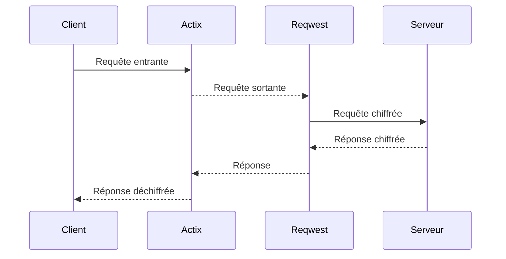
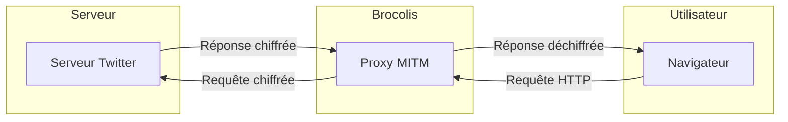
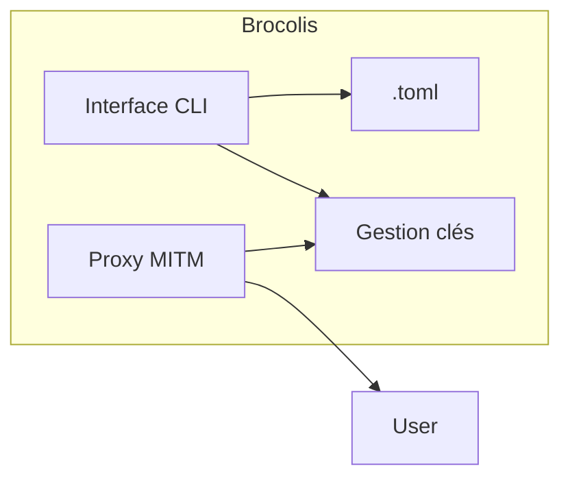
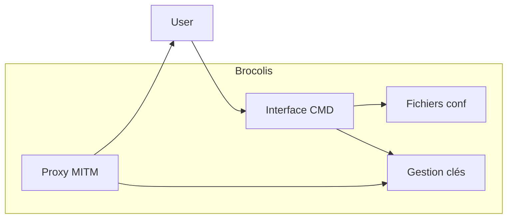

# Brocolis.rs 🥦 - Un proxy MITM Rust pour le chiffrement sélectif du trafic réseau


## Présentation

Brocolis est un proxy MITM (Man In The Middle) développé en Rust permettant de chiffrer sélectivement le trafic HTTP/HTTPS.

Il intercepte les requêtes entre le client et le serveur de manière transparente afin de chiffrer uniquement les données désirées grâce à un système de clés symétriques partageables. 

Brocolis assure ainsi la confidentialité des échanges sur des services comme Twitter, les forums, messageries, etc.


## Proxy MITM

Un proxy MITM (Man In The Middle) est un proxy qui s'intercale entre le client et le serveur et intercepte activement la communication dans les deux sens. 

Il permet d'analyser et même de modifier les requêtes et réponses à la volée avant de les transmettre à leur destination finale.

Le proxy MITM déchiffre, inspecte et potentiellement modifie ou ré-encrypte le trafic de manière transparente pour le client et le serveur.

Les données semblent transiter directement entre le client et serveur alors qu'en réalité elles passent par le proxy MITM.

Cela permet des usages comme l'analyse de trafic, l'ajout de chiffrement, le caching, la restriction d'accès, etc.

Un proxy MITM nécessite des mécanismes d'interception du trafic et de resigning des certificats SSL pour les connexions HTTPS.

## Fonctionnement 

Le proxy MITM est implémenté avec **Actix**. Il écoute les connexions entrantes, analyse le trafic et applique la logique métier de chiffrement/déchiffrement.

**Reqwest** est utilisé par le proxy Actix pour effectuer les requêtes HTTP/HTTPS sortantes vers les serveurs distants. 



Cette architecture permet de séparer clairement les responsabilités :

- **Actix** gère la partie serveur du proxy (connexions, chiffrement, etc)

- **Reqwest** permet d'interagir avec les API/serveurs externes

## Fonctionnalités

| Fonctionnalité | Description |
|-|-|
| Interception MITM | Redirection transparente du trafic via le proxy |
| Certificats SSL | Génération de certificats auto-signés |
| Chiffrement AES-256 | Chiffrement du contenu textuel ciblé | 
| Gestion des clés | Partage sécurisé des clés symétriques |
| Régénération des clés | Rotation automatique en cas de compromission |
| CLI | Interface en ligne de commande |

## Architecture globale

L'architecture générale de Brocolis est la suivante :



Brocolis s'insère entre le client (navigateur) et le serveur pour intercepter toutes les requêtes et réponses HTTP/HTTPS.

Le proxy analyse et chiffre sélectivement le trafic avant de le transmettre à sa destination finale.

Les clés symétriques permettent aux utilisateurs autorisés de consulter les données déchiffrées.

## Architecture interne





L'architecture interne comprend :

- Une interface en ligne de commande (CLI)  
- Fichiers de configuration au format TOML
- Gestionnaire des clés en mémoire
- Proxy MITM implémenté en Rust/Actix/Reqwest

## Installation

Pré-requis : Rust 1.58+

```
$ git clone https://github.com/brocolis/brocolis
$ cd brocolis
$ cargo build --release
```

## Utilisation 

Générer une nouvelle clé :

```
$ brocolis generate-key
Généré la clé 486f9735524b52506e5948724938625a
```

Partager cette clé avec un ami pour chiffrer vos conversations.

Lancer le proxy :

```
$ brocolis proxy
Proxy MITM démarré sur le port 8080
```

Configurer votre navigateur pour utiliser le proxy sur le port 8080.

Le trafic désigné comme devant être chiffré le sera automatiquement avec vos clés !


