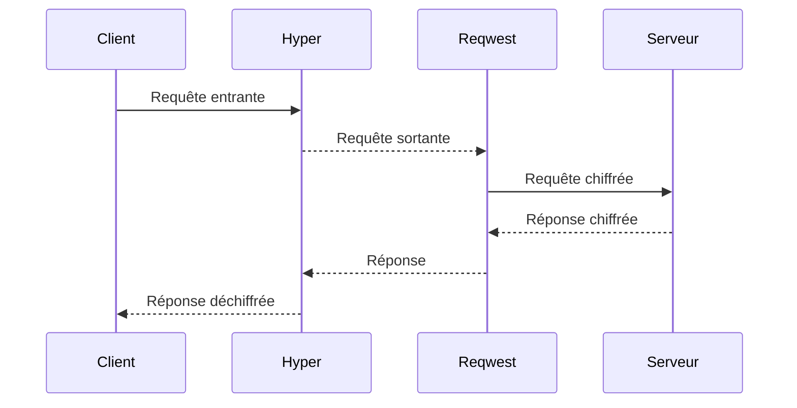
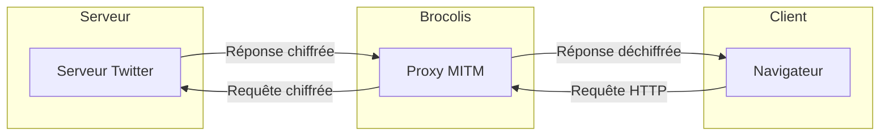
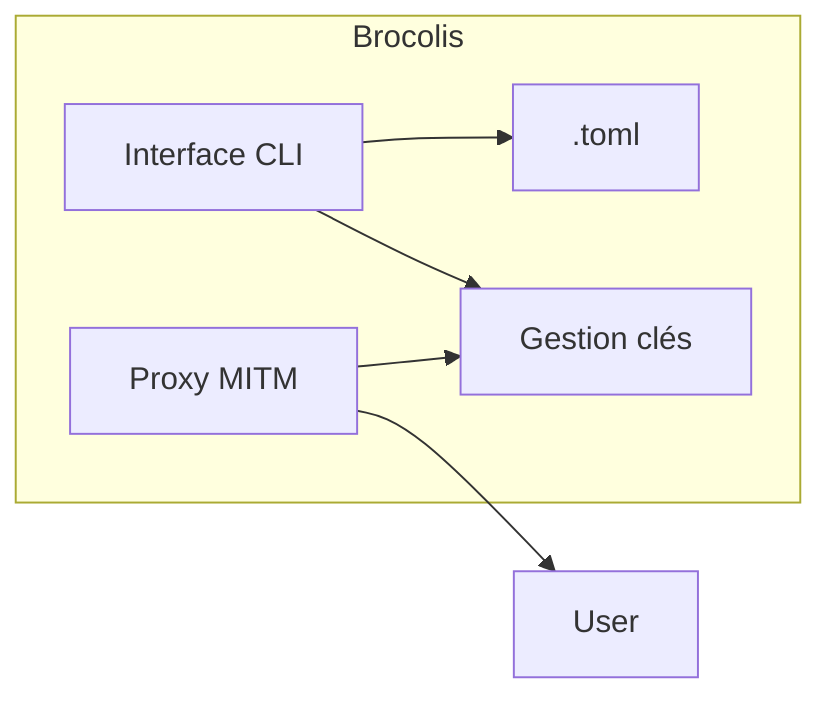
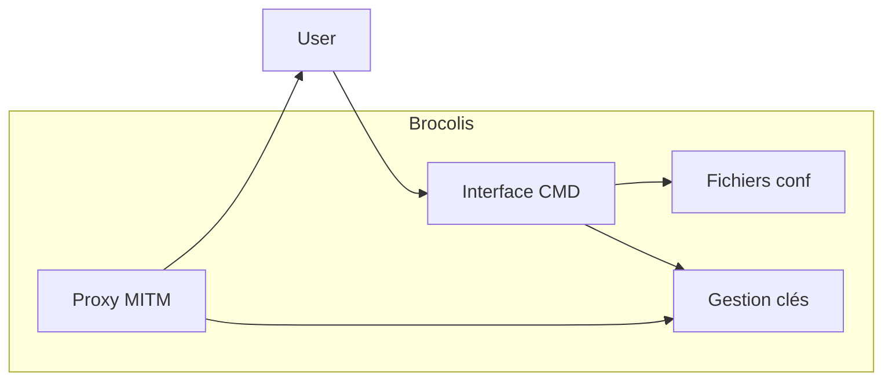

# Brocolis.rs 🥦 - Un proxy MITM Rust pour le chiffrement sélectif du trafic réseau

<!--  -->
<div align="center">
  
</div>

**Conçu et développé par Maxime Nathan Lestage.**

🌐 **Site vitrine** : <https://brocolis-dafbe9beac75.herokuapp.com/> (déployé depuis `master`, servi par `server.js`).

> Le déploiement GitHub Pages a été retiré : Pages n'est pas activable sur un
> dépôt privé (le workflow échouait à chaque push depuis juin), et surtout le
> site y serait bancal — les boutons de téléchargement passent par `/dl/*`,
> relayé par `server.js`, qui n'existe pas sur un hébergement statique.

## Présentation

Brocolis est un proxy MITM (Man In The Middle) développé en Rust permettant de chiffrer sélectivement le trafic HTTP/HTTPS.

Il intercepte les requêtes entre le client et le serveur de manière transparente afin de chiffrer uniquement les données désirées grâce à un système de clés symétriques partageables.

Brocolis assure ainsi la confidentialité des échanges sur des services comme Twitter, les forums, messageries, etc.

## Proxy MITM

Un proxy MITM (Man In The Middle) est un proxy qui s'intercale entre le client et le serveur et intercepte activement la communication dans les deux sens.

Il permet d'analyser et même de modifier les requêtes et réponses à la volée avant de les transmettre à leur destination finale.

Le proxy MITM déchiffre, inspecte et potentiellement modifie ou ré-encrypte le trafic de manière transparente pour le client et le serveur.

Les données semblent transiter directement entre le client et serveur alors qu'en réalité elles passent par le proxy MITM.

Cela permet des usages comme l'analyse de trafic, l'ajout de chiffrement, le caching, la restriction d'accès, etc.

Un proxy MITM nécessite des mécanismes d'interception du trafic et de resigning des certificats SSL pour les connexions HTTPS.

## Fonctionnement

Le proxy MITM est implémenté avec **hyper** (sur le runtime asynchrone
**Tokio**). Il écoute les connexions entrantes, analyse le trafic et applique la
logique métier de chiffrement/déchiffrement. Pour le HTTPS, la requête
`CONNECT` est interceptée et le TLS est terminé localement à l'aide d'un
certificat feuille signé à la volée par le CA de Brocolis (**rustls** +
**rcgen**).

**Reqwest** est utilisé par le proxy pour effectuer les requêtes HTTP/HTTPS
sortantes vers les serveurs distants.



Cette architecture permet de séparer clairement les responsabilités :

- **hyper / Tokio** gèrent la partie serveur du proxy (connexions, TLS,
  chiffrement, etc.)

- **Reqwest** permet d'interagir avec les API/serveurs externes

## Fonctionnalités

| Fonctionnalité        | Description                                     |
| --------------------- | ----------------------------------------------- |
| Interception MITM     | Redirection transparente du trafic via le proxy |
| Certificats SSL       | Génération de certificats auto-signés           |
| Chiffrement AES-256   | Chiffrement du contenu textuel ciblé            |
| Gestion des clés      | Partage sécurisé des clés symétriques           |
| Contacts              | Plusieurs clés par correspondant, chiffrer pour l'un ou plusieurs |
| Message entier        | Sans `((…))`, tout le message est chiffré (hors navigateur) |
| Régénération des clés | Rotation automatique en cas de compromission    |
| CLI                   | Interface en ligne de commande                  |
| Application de bureau | Interrupteur, contacts, messages — macOS, Linux, Windows |

## Architecture globale

L'architecture générale de Brocolis est la suivante :



Brocolis s'insère entre le client (navigateur) et le serveur pour intercepter toutes les requêtes et réponses HTTP/HTTPS.

Le proxy analyse et chiffre sélectivement le trafic avant de le transmettre à sa destination finale.

Les clés symétriques permettent aux utilisateurs autorisés de consulter les données déchiffrées.

## Architecture interne





L'architecture interne comprend :

- Une interface en ligne de commande (CLI)  
- Fichiers de configuration au format TOML
- Gestionnaire des clés en mémoire
- Proxy MITM implémenté en Rust (hyper + Tokio côté serveur, Reqwest côté client)

## Architecture du code

Le cœur est une **bibliothèque** Rust (`src/lib.rs` : modules `agreement`,
`ca`, `config`, `contacts`, `crypto`, `keys`, `pairing`, `proxy`, `system`) exposée via deux
frontends : la **ligne de commande** `brocolis` (`src/main.rs`) et
l'**application de bureau** (`app/`, paquet `brocolis-app`). Les deux forment
un espace de travail Cargo et partagent le même `target/`. La configuration système automatique
(`brocolis auto`) est prise en charge nativement sur **macOS, Linux et
Windows** (module `system`, un sous-module par OS) ; le proxy et le
chiffrement eux-mêmes fonctionnent partout où Rust compile.

## Installation

Pré-requis : Rust stable récent.

```
git clone https://github.com/maxlestage/brocolis
cd brocolis
cargo build --release      # binaire: target/release/brocolis
```

## Application de bureau (macOS, Linux, Windows)

Une petite fenêtre pour ce que la ligne de commande fait en plusieurs
commandes. Trois onglets :

- **Protection** — un interrupteur. Il démarre le proxy dans l'application
  (ou utilise le service système s'il tourne déjà), puis branche le système
  dessus ; recliqué, il remet la configuration d'origine. L'état est relu en
  continu : un `brocolis on`/`off` lancé dans un terminal s'y reflète. On y
  choisit aussi **pour qui le navigateur chiffre** : vous (clé principale) ou
  un ou plusieurs contacts.
- **Contacts** — un nom, et **une ou plusieurs clés** par contact : la clé
  active chiffre ce qu'on lui envoie, les autres (anciennes, clé de groupe…)
  servent encore à lire. Créer un contact (sa clé est générée et copiée, ou
  collée), ajouter une clé, choisir l'active, renommer, supprimer (avec
  confirmation), **appairer par un code** convenu de vive voix et ranger la
  clé obtenue sous un nom (même protocole et même empreinte que
  `brocolis pair` et l'app iOS). Les clés sans nom restent gérées comme avant,
  et peuvent être rangées sous un contact.
- **Message** — choisir les destinataires (vous, un ou plusieurs contacts),
  puis chiffrer : les `((segments marqués))` s'il y en a, **sinon tout le
  message**. Plusieurs destinataires : un seul jeton que chacun ouvre avec sa
  clé. Un message reçu se déchiffre avec toutes les clés, et l'application dit
  de quel contact il vient.

Brancher le système (magasin de confiance, proxy système) exige les droits
administrateur, que l'application ne garde jamais : elle les demande au clic,
avec la boîte de dialogue native — mot de passe ou Touch ID sur macOS, `pkexec`
sur Linux, contrôle de compte d'utilisateur sur Windows — et fait exécuter
`brocolis on` / `off` par la ligne de commande livrée avec elle. Si on la ferme
protection active, elle la coupe d'abord : sinon le système resterait dirigé
vers un proxy arrêté.

Ses données sont propres à chaque utilisateur : `~/Library/Application
Support/Brocolis` (macOS), `~/.config/brocolis` (Linux), `%APPDATA%\Brocolis`
(Windows) — configuration au même format que `brocolis.toml`, CA et identité
d'appairage. Interface en français, anglais ou espagnol selon le système.

| OS      | Livraison                                                          |
| ------- | ------------------------------------------------------------------ |
| macOS   | `Brocolis.app` dans l'archive universelle, à glisser dans Applications |
| Linux   | installée par les paquets `.deb` / `.rpm` (menu des applications)  |
| Windows | `brocolis-app.exe` dans l'archive, à côté de `brocolis.exe`        |

> macOS : l'application n'est pas signée par un compte développeur Apple. Au
> premier lancement, clic droit → **Ouvrir** (ou Réglages Système →
> Confidentialité et sécurité → **Ouvrir quand même**).

Développement :

```sh
cargo run -p brocolis-app      # lancer l'application
cargo test -p brocolis-app     # tests, dont l'interface pilotée par egui_kittest
```

L'interface est écrite avec [egui](https://github.com/emilk/egui) (rendu
OpenGL via glow), aux couleurs et dans la police du site. Ses tests la
pilotent comme un utilisateur, par l'arbre d'accessibilité : activer puis
couper la protection, refuser l'autorisation, gérer le trousseau et les
contacts, choisir les destinataires, chiffrer puis déchiffrer un message.

## Utilisation (CLI)

### Installer une fois, activer à volonté : `on` / `off` / `status`

`auto` occupe un terminal et tout se défait quand on le ferme. Pour un usage
quotidien, on installe le service **une seule fois** — LaunchDaemon sur macOS
(`macos/install.sh`), service systemd sur Linux (posé par le paquet `.deb` /
`.rpm`) — puis on bascule à la demande :

```sh
$ sudo brocolis on        # dirige le système vers le proxy, mémorise l'état d'avant
✅ Chiffrement actif (proxy 127.0.0.1:8080).

$ brocolis status
actif

$ sudo brocolis off       # remet EXACTEMENT la configuration d'origine
✅ Chiffrement coupé, état d'origine restauré.
```

Les commandes rendent la main : rien à laisser ouvert. Le service continue de
tourner en tâche de fond ; `on`/`off` ne font que brancher ou débrancher le
système dessus.

L'état d'avant-activation est mémorisé dans `/etc/brocolis/etat-precedent.json`
— `%ProgramData%\Brocolis\etat-precedent.json` sous Windows — (modifiable avec
`--state`). Sous Windows, où aucun service n'est installé, c'est l'application
de bureau qui fait tourner le proxy et sert d'interrupteur. C'est lui qui permet à `off` de restaurer
fidèlement — un `on` déjà actif refuse donc de réengager, pour ne pas écraser
cette trace. Au premier `on`, le CA est généré s'il n'existe pas encore.

### Tout-en-un : `brocolis auto` (macOS, Linux, Windows)

La façon la plus simple. Une seule commande :

```
$ sudo brocolis auto --config brocolis.toml
```

#### Sur macOS

Elle exécute, sans rien d'autre à faire :

1. **Confiance du CA — Safari & Chrome** : ajoute le certificat racine au
   *trousseau Système* (`security add-trusted-cert …
   /Library/Keychains/System.keychain`) ;
2. **Confiance du CA — Firefox** : Firefox n'utilise pas le trousseau
   macOS ; `auto` dépose donc une politique entreprise
   (`Certificates.ImportEnterpriseRoots = true`,
   `…/distribution/policies.json`) dans **chaque** variante détectée
   (Firefox, Developer Edition, Nightly, ESR). Une politique
   préexistante n'est **jamais** écrasée (un avertissement est émis).
   En complément, un profil de configuration
   `brocolis-firefox.mobileconfig` est généré à côté du CA : c'est une
   **alternative qui ne modifie pas le bundle** de l'app (à
   double-cliquer puis approuver dans *Réglages Système → Confidentialité
   et sécurité → Profils* — étape manuelle imposée par macOS) ;
3. **Proxy système** — règle le proxy *web* et *HTTPS* sur
   `127.0.0.1:<port>` pour le service réseau actif (`networksetup`) ;
4. **Chiffrement** — démarre le proxy MITM ;
5. **Restauration** — à l'arrêt (`Ctrl-C` / `SIGTERM`), remet le proxy
   système dans son état initial et retire les politiques Firefox et le
   `.mobileconfig` que `auto` avait créés.

Ainsi **aucune installation manuelle de certificat** n'est nécessaire :
Safari, Chrome et Firefox font confiance au CA automatiquement (la
méthode par défaut Firefox modifie son bundle ; le `.mobileconfig`
fourni est l'alternative sans modification de bundle).

#### Pourquoi `sudo` ?

Écrire dans le magasin de confiance système (trousseau macOS,
`/usr/local/share/ca-certificates/` ou équivalent sur Linux) et
modifier le proxy système exige les droits administrateur. macOS
demande donc le mot de passe administrateur **une seule fois** au
lancement de `sudo brocolis auto` ; c'est une frontière de sécurité
imposée par l'OS, qu'aucun logiciel ne peut contourner. Sans `sudo`,
`brocolis auto` détecte l'absence de droits, l'indique clairement et
démarre le proxy **sans** toucher au système (équivalent à
`--no-system`).

#### Sur Linux

`brocolis auto` détecte la famille de distribution (Debian/Ubuntu,
Fedora/RHEL ou Arch) via la présence des outils standard
(`update-ca-certificates`, `update-ca-trust`, `trust extract-compat`).
Il dépose alors :

1. Le CA dans le magasin de confiance distro
   (`/usr/local/share/ca-certificates/` sur Debian,
   `/etc/pki/ca-trust/source/anchors/` sur RHEL,
   `/etc/ca-certificates/trust-source/anchors/` sur Arch) +
   commande de mise à jour ;
2. La politique entreprise Firefox dans
   `/etc/firefox/policies/policies.json` (sans modifier le bundle) ;
3. Un fichier `/etc/profile.d/brocolis-proxy.sh` qui exporte
   `http_proxy`/`https_proxy` pour les **nouvelles** sessions shell
   (`source` ce fichier pour la session courante).

L'arrêt (Ctrl-C / SIGTERM) restaure exactement l'état initial : CA
retiré du magasin, politique Firefox retirée, `/etc/profile.d/`
nettoyé. Les ressources préexistantes (CA déjà présent, politique
déjà déposée) ne sont **jamais** touchées.

Pour une installation persistante avec service systemd, voir le
dossier [`linux/`](linux/) (`.deb` / `.rpm` ou `install.sh`).

#### Sur Windows

Depuis un terminal **Exécuter en tant qu'administrateur** :

```
> brocolis.exe auto --config brocolis.toml
```

`auto` :

1. Approuve le CA dans **Local Machine\Trusted Root Certification
   Authorities** via `certutil -addstore -f Root <ca>` ;
2. Dépose la politique entreprise Firefox dans chaque variante
   détectée (`<install>\distribution\policies.json`) ;
3. Règle le proxy **WinHTTP** système (`netsh winhttp set proxy
   proxy-server="127.0.0.1:<port>" bypass-list="<local>"`), après
   sauvegarde de l'état initial.

`Ctrl-C` restaure l'état initial : CA retiré du magasin, politique
Firefox retirée, WinHTTP remis comme avant. Les ressources préexistantes
(CA déjà présent, politique déjà déposée) ne sont jamais touchées.

Pour une installation persistante, voir le dossier
[`windows/`](windows/) (`install.ps1` / `uninstall.ps1`).

> **WinHTTP** couvre les apps qui utilisent l'API WinHTTP (services,
> certains outils CLI). Les navigateurs **WinINet** (Edge, Chrome) lisent
> `HKCU\…\Internet Settings`, par utilisateur — non automatisé par
> `auto`. Configurez-les à la main, ou comptez sur la politique Firefox
> déjà déposée.

> Autres OS (BSD, …) : la configuration système automatique n'est
> **pas** prise en charge. `brocolis auto` lance le proxy et signale
> qu'il faut pointer le client sur `127.0.0.1:<port>` manuellement.
> `--no-system` lance le proxy sans aucune modification système.

### Chiffrer un message sans navigateur : `encrypt` / `decrypt`

Hors ligne, pour vérifier une clé, préparer un message à coller ailleurs ou
lire un jeton reçu par un autre canal. Avec des `((parenthèses))`, seuls ces
segments sont chiffrés — exactement comme le proxy ; **sans parenthèses, c'est
tout le message** qui devient un seul jeton.

```sh
$ cle=$(brocolis keygen)                 # la clé seule sur stdout
$ brocolis encrypt --key "$cle" --text 'rdv ((code 4291)) a 18h'
rdv [[BROCOLIS:v1:Ob376+nksSGoCRycfGa31Wl6DsujMD3eJReu6ZJDJK8IoLwjfQ==]] a 18h

$ echo '<jeton collé ici>' | brocolis decrypt --key "$cle"
rdv code 4291 a 18h
```

Sans `--key`, `encrypt` chiffre pour les contacts `--to` (répétable), sinon
pour les destinataires `encrypt_to` de `brocolis.toml`, sinon avec la clé
principale ; `decrypt` essaie tout le trousseau, contacts compris, et dit de
qui vient le message. Le texte peut venir de `--text` ou de l'entrée standard.
Seul le texte transformé va sur stdout (le compte de segments et les journaux
partent sur stderr), donc les commandes s'enchaînent dans un tube. Un jeton
qu'aucune clé n'ouvre est laissé tel quel, sans erreur : c'est un message
destiné à quelqu'un d'autre.

### Contacts : plusieurs clés par correspondant

```sh
$ brocolis contacts add Alice              # crée Alice ; sa clé seule sur stdout,
<clé base64, à transmettre à Alice>        # à lui transmettre par un canal sûr
$ brocolis contacts add Alice --key "$k"   # une clé de plus pour Alice
$ brocolis pair --code 4291 --name Bob     # appairage, clé rangée sous Bob
$ brocolis contacts
Alice
   active   617E-6FC9-ABFF-B902
   lecture  4D03-935B-179B-219C
Bob
   active   D6FA-8246-03F6-0ED4

$ brocolis encrypt --to Alice --text 'On se voit demain'
[[BROCOLIS:v1:…]]                          # tout le message, pour Alice
$ brocolis encrypt --to Alice --to Bob --text 'rdv ((18h))'
rdv [[BROCOLIS:v2:…]]                      # un seul jeton, lisible par les deux
$ brocolis decrypt --text '[[BROCOLIS:v1:…]]'
On se voit demain
# 1 jeton(s) déchiffré(s) — de : Alice
```

La première clé d'un contact est sa clé **active** (elle chiffre) ;
`contacts use NOM CLÉ` en change, `contacts remove NOM [--key CLÉ]` retire un
contact ou l'une de ses clés, `contacts rename ANCIEN NOUVEAU` le renomme. Pour
que le proxy chiffre pour des contacts, listez-les dans `encrypt_to` (voir
`brocolis.example.toml`).

### Commandes de base

Générer une clé symétrique AES-256 à partager (canal sûr) :

```
$ brocolis keygen
SomopQcHJyVQQAWedZFGY5E4+hxKjZemOB7aGnYr6kw=
```

Générer le certificat racine et l'installer comme autorité de confiance dans
le navigateur (nécessaire pour l'interception HTTPS) :

```
$ brocolis ca --export brocolis-ca.crt
```

Lancer le proxy (place la clé dans `brocolis.toml`, cf. `brocolis.example.toml`) :

```
$ brocolis run --config brocolis.toml
Brocolis écoute sur http://127.0.0.1:8080 (proxy HTTP/HTTPS)
```

Configurer le navigateur pour utiliser le proxy HTTP/HTTPS sur ce port.

Sur Unix, la gestion des clés se pilote par signaux : `SIGHUP` régénère la clé
(rotation en cas de compromission), `SIGUSR1` recharge la clé partagée depuis
le fichier de configuration.

## Binaires précompilés

**Aucune manipulation requise.** À chaque push sur `master`, des workflows
GitHub Actions compilent le binaire `brocolis` pour les **trois OS** et
publient/actualisent automatiquement la release GitHub **`cli-latest`** :

| OS      | Workflow                                  | Artefact                          |
| ------- | ----------------------------------------- | --------------------------------- |
| macOS   | `.github/workflows/macos-cli-release.yml` | `brocolis-macos-universal.tar.gz` (`Brocolis.app` + `brocolis`, universels Intel + Apple Silicon) |
| Linux   | `.github/workflows/linux-cli-release.yml` | paquets `.deb` (Debian/Ubuntu) et `.rpm` (Fedora/RHEL), x86_64 — application + CLI |
| Windows | `.github/workflows/windows-cli-release.yml` | `brocolis-windows-x86_64.zip` (`brocolis-app.exe` + `brocolis.exe` + `install.ps1` / `uninstall.ps1`) |

`Rust CI` compile et teste en plus tout l'espace de travail sur les **trois
OS** à chaque push, sur toutes les branches.

Il suffit de télécharger l'artefact correspondant à votre OS depuis l'onglet
*Releases*. Un tag `v*` produit en plus une release versionnée.

### Site vitrine : application WebAssembly

Le site (`site/`) est une application **Yew compilée en WebAssembly** — même
langage que le proxy, donc une seule chaîne d'outils pour tout le dépôt.
Trois langues (fr/en/es), trois thèmes, routage par fragment d'URL, aucun
appel réseau en dehors des téléchargements.

```sh
cd site
trunk serve            # développement, rechargement à chaud sur :8081
trunk build --release  # production → site/dist
```

Il faut `trunk` (`cargo install trunk --locked`) et la cible
`wasm32-unknown-unknown` (`rustup target add wasm32-unknown-unknown`).

**Mouvement.** Le langage visuel s'inspire de zamocorp.com, et chaque bloc
de la page bouge :

- ouverture : rideau avec compteur (une fois par session), scène épinglée où
  la mascotte se forme dans la poussière puis est balayée par la lumière,
  halo et orbite autour d'elle, mascotte qui pivote vers le pointeur, badge
  circulaire qui tourne, lettres du titre qui sautillent avec la vitesse de
  défilement ;
- texte : titres qui montent mot à mot, petits libellés qui se « déchiffrent »
  (à l'apparition et au survol), manifeste qui s'allume mot à mot, liens et
  boutons dont le libellé roule au survol ;
- démonstration : un message se tape, son segment secret se scelle en jeton
  `[[BROCOLIS:v1:…]]` côté serveur et se rouvre chez les proches — en boucle
  tant qu'elle est à l'écran ;
- sections : filet qui se trace, numéro fantôme géant en parallaxe, cartes
  qui basculent en 3D à l'apparition puis s'inclinent sous le pointeur, coches
  dessinées au trait, commande tapée dans le terminal, lignes qui défilent ;
- défilement : bandeaux dont la vitesse et le sens suivent ceux du
  défilement, repère de la section courante (et lien du menu marqué), barre
  de progression, barre de navigation qui s'efface ;
- pied de page : bandeau évidé à contresens, mot géant dont les lettres se
  rassemblent ; volet en deux couches entre les pages ; grain, curseur
  anneau (avec libellé sur certaines zones), boutons aimantés.

Aucune bibliothèque JavaScript : tout est en Rust (`site/src/motion/`), une
seule boucle `requestAnimationFrame` qui s'arrête quand rien ne bouge. Les
composants posent des attributs (`data-reveal`, `data-scramble`,
`data-progress`, `data-marquee`, `data-tilt`, `data-magnetic`…, liste
complète en tête de `motion/mod.rs`), le contrôleur les découvre dans le DOM
et écrit des variables CSS ; la feuille de style en fait du mouvement. Le
texte « déchiffré » réécrit le nœud texte de Yew sans le remplacer, et suit
un changement de langue survenu en cours d'animation. Le défilement reste
natif (pas de défilement « lissé »). Sous `prefers-reduced-motion: reduce`,
rien n'est épinglé ni caché, et la démonstration est figée sur son état final.

Polices auto-hébergées (`site/public/fonts`, licence OFL) : Archivo variable
pour le texte, Fraunces italique pour les mots d'accent.

**`site/dist` est versionné**, contrairement à l'usage. Raison : Heroku
construit ce dépôt avec le buildpack Node, qui n'a pas de chaîne Rust — le
site ne peut donc pas être compilé sur le dyno. Conséquence pratique : après
toute modification de `site/`, **reconstruire et committer `site/dist`**,
sinon le déploiement sert l'ancienne version. `npm run heroku-postbuild`
(exécuté par Heroku) lance `scripts/check-dist.mjs`, qui fait échouer le
déploiement si `site/dist` est absent ou incomplet — mais il ne peut pas
détecter un `dist` simplement périmé.

> Alternative possible : ajouter un buildpack Rust à l'application Heroku pour
> compiler à chaque déploiement. Écartée ici parce que l'installation de
> `trunk` depuis les sources prend à elle seule ~6 minutes, ce qui approche la
> limite de build de Heroku.

### Relais de téléchargement (`/dl/*`)

Ce dépôt est **privé**, donc ses assets de release renvoient `404` à toute
requête non authentifiée. Les boutons du site ne pointent donc pas vers
GitHub mais vers `/dl/<plateforme>` (`macos`, `linux-deb`, `linux-rpm`,
`windows`), relayé par `server.js` : le serveur récupère l'asset avec son
jeton et le retransmet au visiteur. Le dépôt reste privé, les
téléchargements sont publics.

Le relais lit la release à la volée (au lieu de copier les binaires dans le
slug au build) parce que les releases sont *rolling* : elles sont
reconstruites à chaque push sur `master`.

**Variable d'environnement requise sur Heroku :**

```sh
heroku config:set GITHUB_TOKEN=<jeton avec accès en lecture au dépôt>
```

Un jeton *fine-grained* limité à ce dépôt avec la permission **Contents:
Read** suffit. Sans lui, le site fonctionne normalement mais `/dl/*` répond
`503` (jeton invalide ou expiré : `502`).

## Limites connues

> ### Ce que le chiffrement protège — et ce qu'il ne protège pas
>
> Le serveur ne **stocke** que du chiffré : c'est la garantie de l'outil, et
> elle tient. Mais au moment où vous consultez la page, brocolis réinjecte le
> clair **dans le document**, donc le **JavaScript du site peut le lire** (via
> le DOM) et le renvoyer à son serveur.
>
> Autrement dit : brocolis protège vos messages d'un serveur qui les archive,
> pas d'un site activement hostile qui inspecte ce que votre navigateur
> affiche. C'est inhérent au principe d'un proxy qui déchiffre dans la page ;
> aucun réglage ne le contourne.


- **WebSocket non relayé.** Brocolis ne sait pas suivre un changement de
  protocole : les en-têtes `Connection`/`Upgrade` sont retirés et une réponse
  `101` n'est pas traitée. Les fonctions temps réel d'un site (chat, flux live)
  échouent donc derrière le proxy. Un avertissement est journalisé à chaque
  tentative, pour que la panne soit diagnosticable.
- **Marqueurs à cheval sur deux champs.** Un `((` dans un champ et un `))` dans
  un autre ne sont pas appariés : la détection travaille champ par champ.
- **Réécriture plafonnée à 8 Mio.** Au-delà, le corps est relayé sans
  réécriture (voir `MAX_REWRITE_BYTES`) — les messages visés pèsent quelques
  kilo-octets.
- **Trousseau limité à 255 clés** en chiffrement multi-destinataire (le format
  `v2` code le nombre sur un octet). Au-delà, le segment n'est pas chiffré : il
  est remplacé par un marqueur d'erreur visible, jamais émis en clair.

## Tests d'intégration système

Chaque OS dispose d'un script qui valide, sur une vraie machine, le cycle
complet de `brocolis auto` : ajout **puis retrait** du CA du magasin de
confiance, réglage **puis restauration** du proxy système, pose et retrait
de la politique Firefox, un vrai flux HTTPS au travers du proxy, et le
round-trip du chiffrement sélectif. Chaque script **restaure l'état
initial** du système à la fin et se termine avec un code non nul si une
vérification échoue.

| OS      | Script                                  |
| ------- | --------------------------------------- |
| macOS   | `bash scripts/test-macos.sh` (ajoute aussi le `.mobileconfig`) |
| Linux   | `sudo bash linux/test-auto.sh`          |
| Windows | `windows/test-auto.ps1` (terminal administrateur) |

Sur macOS/Linux, le script demande **une fois** le mot de passe
administrateur (`sudo`).

En complément, la logique pure (format de jeton, parsing de configuration,
détection système) est couverte par les tests unitaires et d'intégration
Rust :

```
cargo test
```

## Chiffrement sélectif

Seul le contenu **explicitement marqué** est chiffré : tout segment
`((texte secret))` d'une requête est remplacé par un jeton
`[[BROCOLIS:v1:…]]` (AES-256-GCM) ; les jetons reçus dans les réponses sont
déchiffrés à la volée. Le service distant ne stocke donc que du chiffré, alors
que les utilisateurs partageant la clé voient le texte en clair.

Dans le trafic web, seul ce qui est marqué est chiffré (chiffrer une requête
entière la rendrait illisible pour le service). Le message entier, lui, se
chiffre hors navigateur : `brocolis encrypt` ou l'onglet Message de
l'application. Les destinataires du proxy se choisissent avec `encrypt_to` :
la clé active de chaque contact nommé, un jeton `v2` s'ils sont plusieurs.

### Format de jeton (contrat d'interopérabilité)

Un jeton est `[[BROCOLIS:v1:<base64>]]`, où `<base64>` encode la charge
binaire :

```
nonce (12 octets) || ciphertext || tag (16 octets)
```

- **Chiffrement** : AES-256-GCM, clé de 32 octets partagée, **tag de 128 bits**.
- **Nonce / IV** : 12 octets (96 bits), aléatoire à chaque jeton.
- **Empaquetage** : c'est exactement la représentation `combined` de CryptoKit
  (`AES.GCM.SealedBox`) côté iOS, et `iv + Cipher.doFinal(...)` côté Android.
- **Base64** : brocolis **émet** l'alphabet standard avec padding, mais
  **accepte** en entrée le standard comme l'URL-safe, avec ou sans padding —
  un client Android utilisant `Base64.URL_SAFE` reste donc compatible.

Ce format est **interopérable** avec n'importe quel client tiers, notamment les
apps **iOS** (CryptoKit) et **Android** (`javax.crypto.Cipher`). Des **vecteurs
figés** verrouillent la compatibilité binaire :
`tests/interop_ios.rs` et `tests/interop_android.rs`
(`cargo test --test interop_ios --test interop_android`). Si le format dérivait
(préfixe, base64, ordre nonce/tag, longueur de tag), ces tests échoueraient.

#### Client iOS (Swift / CryptoKit)

```swift
import CryptoKit
let key = SymmetricKey(data: sharedKey)            // 32 octets
let sealed = try AES.GCM.seal(Data(plaintext.utf8), using: key)
let token = "[[BROCOLIS:v1:" + sealed.combined!.base64EncodedString() + "]]"
// Déchiffrement : AES.GCM.open(AES.GCM.SealedBox(combined: data), using: key)
```

#### Client Android (Kotlin / `javax.crypto`)

```kotlin
val cipher = Cipher.getInstance("AES/GCM/NoPadding")
val iv = ByteArray(12).also { SecureRandom().nextBytes(it) }
cipher.init(Cipher.ENCRYPT_MODE, SecretKeySpec(sharedKey, "AES"),
            GCMParameterSpec(128, iv))             // tag 128 bits
val packed = iv + cipher.doFinal(plaintext.toByteArray())   // nonce || ct || tag
val token = "[[BROCOLIS:v1:" +
    Base64.encodeToString(packed, Base64.NO_WRAP) + "]]"
// Déchiffrement : séparer iv(12) du reste, GCMParameterSpec(128, iv), doFinal.
```

# Organisation du code avec Git

## Branches

- `master` - branche principale contenant le code en production
- `dev` - branche de développement pour le travail en cours
- `feature/nom` - branches de feature pour les nouvelles fonctionnalités
- `bugfix/nom` - branches pour corriger des bugs
- `release/version` - branches pour préparer les releases

Les pull requests doivent être faites de la branche de travail vers `dev`.

## Nommage des commits

- Utiliser l'impératif au présent : "Fix bug", "Add feature"
- Donner suffisamment de contexte pour comprendre facilement les changements

## Conventions de code

- Suivre le style de codage défini par le linter Rust Clippy
- Privilégier les noms de variables et fonctions explicites
- Commenter le code pour expliquer l'intention et les choix techniques
- Garder le code simple et éviter les optimisations prématurées
- Couvrir le code par des tests unitaires et d'intégration

## Pull requests

- Ouvrir les PRs pour toute contribution significative
- Expliquer clairement l'objectif et les changements
- Limiter la portée des PRs pour faciliter la revue
- S'assurer que tous les tests passent avant de merger

## Releases

- Les numéros de version suivent SemVer (MAJEUR.MINEUR.PATCH)
- Créer une release GitHub pour chaque version
- Générer des notes de release décrivant les changements

# Licence

Ce logiciel est la propriété exclusive de LESTAGE Maxime Nathan et ne peut pas être copié, modifié, distribué ou utilisé sans autorisation écrite préalable.

Le code source de ce logiciel n'est pas fourni et ne peut pas être réutilisé sans permission. Seuls les binaires compilés sont distribués aux utilisateurs finaux selon les termes du contrat de licence utilisateur final (CLUF).

Ce logiciel est protégé par le droit d'auteur et par les lois sur la propriété intellectuelle en vigueur. Toute copie, modification, distribution ou utilisation en violation de cette licence propriétaire est strictement interdite et passible de poursuites judiciaires.

LESTAGE Maxime Nathan se réserve le droit de poursuivre en justice toute personne contrevenant à cette licence propriétaire du logiciel.

Cette clause indique clairement que:

- Le code source est privé et propriétaire
- Aucun droit n'est concédé sur le code
- Seule l'utilisation du binaire sous licence est autorisée
- La copie ou redistribution est interdite

# ⚠️ AVERTISSEMENT ⚠️

Ce logiciel, Brocolis.rs, est mis à disposition "TEL QUEL" par Maxime Nathan LESTAGE, l'auteur, sans aucune garantie explicite ou implicite. L'auteur décline toute responsabilité quant à ce logiciel, y compris les garanties implicites de qualité marchande et d'adéquation à un usage particulier. En aucun cas, Maxime Nathan LESTAGE ne pourra être tenu pour responsable des dommages spéciaux, directs, indirects ou consécutifs, ou de tout autre préjudice découlant de la perte d'utilisation, de données ou de profits, que ce soit dans le cadre d'un contrat, d'une négligence ou de toute autre action délictuelle, liée à l'utilisation ou à la performance de ce logiciel.

Veuillez noter les points suivants :

- Ce logiciel est fourni "TEL QUEL", sans aucune garantie explicite ou implicite.
- L'auteur ne garantit pas que le logiciel sera exempt d'erreurs ou de défauts.
- Vous assumez l'entière responsabilité de l'utilisation de ce logiciel et de ses conséquences.
- L'auteur ne sera pas tenu responsable des éventuels problèmes, pertes de données ou dommages résultant de l'utilisation de ce logiciel.
- En utilisant ce logiciel, vous acceptez les termes de cette licence et assumez tous les risques qui y sont associés.

Nous vous recommandons vivement de prendre toutes les précautions nécessaires lors de l'utilisation de ce logiciel. En cas de doute quant à son fonctionnement ou à ses effets, il est conseillé de consulter un professionnel qualifié.

UTILISEZ CE LOGICIEL À VOS PROPRES RISQUES.
