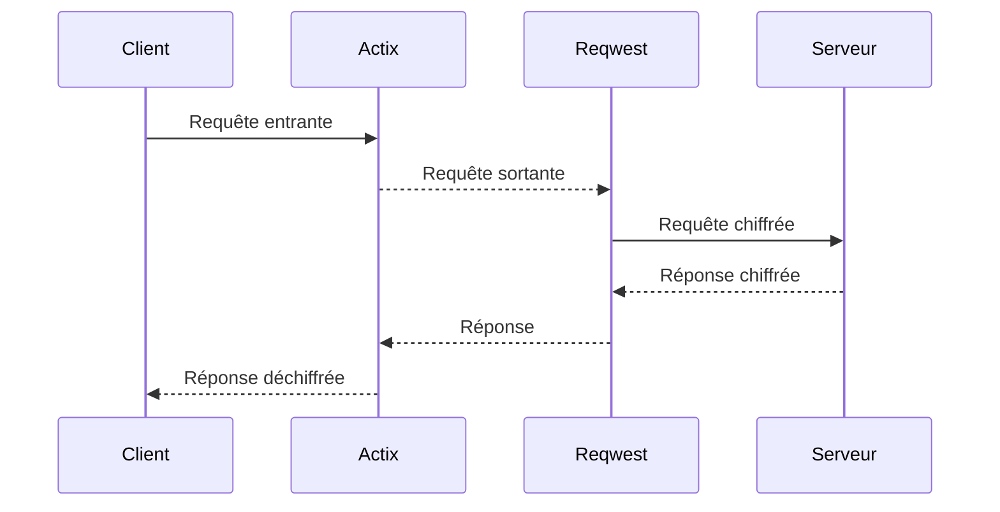
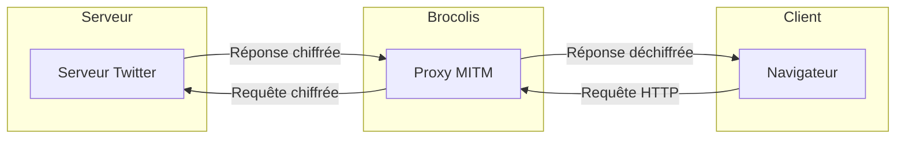
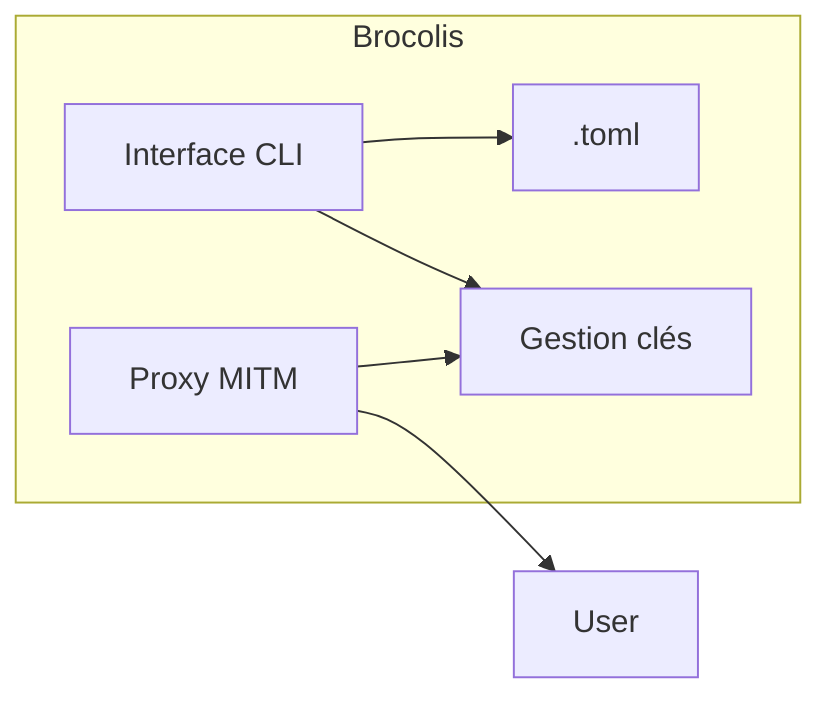
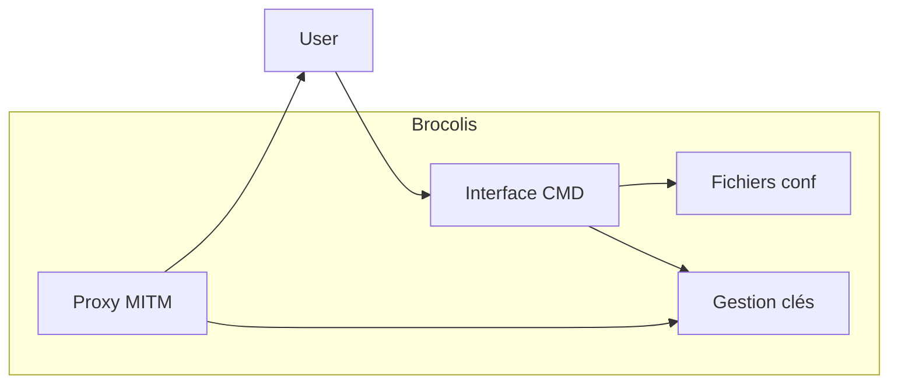

# Brocolis.rs 🥦 - Un proxy MITM Rust pour le chiffrement sélectif du trafic réseau

<!--  -->
<div align="center">
  
</div>

## Présentation

Brocolis est un proxy MITM (Man In The Middle) développé en Rust permettant de chiffrer sélectivement le trafic HTTP/HTTPS.

Il intercepte les requêtes entre le client et le serveur de manière transparente afin de chiffrer uniquement les données désirées grâce à un système de clés symétriques partageables.

Brocolis assure ainsi la confidentialité des échanges sur des services comme Twitter, les forums, messageries, etc.

## Proxy MITM

Un proxy MITM (Man In The Middle) est un proxy qui s'intercale entre le client et le serveur et intercepte activement la communication dans les deux sens.

Il permet d'analyser et même de modifier les requêtes et réponses à la volée avant de les transmettre à leur destination finale.

Le proxy MITM déchiffre, inspecte et potentiellement modifie ou ré-encrypte le trafic de manière transparente pour le client et le serveur.

Les données semblent transiter directement entre le client et serveur alors qu'en réalité elles passent par le proxy MITM.

Cela permet des usages comme l'analyse de trafic, l'ajout de chiffrement, le caching, la restriction d'accès, etc.

Un proxy MITM nécessite des mécanismes d'interception du trafic et de resigning des certificats SSL pour les connexions HTTPS.

## Fonctionnement

Le proxy MITM est implémenté avec **Actix**. Il écoute les connexions entrantes, analyse le trafic et applique la logique métier de chiffrement/déchiffrement.

**Reqwest** est utilisé par le proxy Actix pour effectuer les requêtes HTTP/HTTPS sortantes vers les serveurs distants.



Cette architecture permet de séparer clairement les responsabilités :

- **Actix** gère la partie serveur du proxy (connexions, chiffrement, etc)

- **Reqwest** permet d'interagir avec les API/serveurs externes

## Fonctionnalités

| Fonctionnalité        | Description                                     |
| --------------------- | ----------------------------------------------- |
| Interception MITM     | Redirection transparente du trafic via le proxy |
| Certificats SSL       | Génération de certificats auto-signés           |
| Chiffrement AES-256   | Chiffrement du contenu textuel ciblé            |
| Gestion des clés      | Partage sécurisé des clés symétriques           |
| Régénération des clés | Rotation automatique en cas de compromission    |
| CLI                   | Interface en ligne de commande                  |

## Architecture globale

L'architecture générale de Brocolis est la suivante :



Brocolis s'insère entre le client (navigateur) et le serveur pour intercepter toutes les requêtes et réponses HTTP/HTTPS.

Le proxy analyse et chiffre sélectivement le trafic avant de le transmettre à sa destination finale.

Les clés symétriques permettent aux utilisateurs autorisés de consulter les données déchiffrées.

## Architecture interne





L'architecture interne comprend :

- Une interface en ligne de commande (CLI)  
- Fichiers de configuration au format TOML
- Gestionnaire des clés en mémoire
- Proxy MITM implémenté en Rust/Actix/Reqwest

## Architecture du code

Le cœur est une **bibliothèque** Rust (`src/lib.rs` : modules `ca`, `config`,
`crypto`, `keys`, `proxy`, `system`) exposée via un unique frontend, la
**ligne de commande** `brocolis`. La configuration système automatique
(`brocolis auto`) cible **macOS** ; le proxy et le chiffrement eux-mêmes
fonctionnent partout où Rust compile.

## Installation

Pré-requis : Rust stable récent.

```
git clone https://github.com/maxlestage/brocolis
cd brocolis
cargo build --release      # binaire: target/release/brocolis
```

## Utilisation (CLI)

### Tout-en-un : `brocolis auto` (macOS)

La façon la plus simple, **sur macOS**. Une seule commande :

```
$ sudo brocolis auto --config brocolis.toml
```

Elle exécute, sans rien d'autre à faire :

1. **Confiance du CA — Safari & Chrome** : ajoute le certificat racine au
   *trousseau Système* (`security add-trusted-cert …
   /Library/Keychains/System.keychain`) ;
2. **Confiance du CA — Firefox** : Firefox n'utilise pas le trousseau
   macOS ; `auto` dépose donc une politique entreprise
   (`Certificates.ImportEnterpriseRoots = true`,
   `…/distribution/policies.json`) dans **chaque** variante détectée
   (Firefox, Developer Edition, Nightly, ESR). Une politique
   préexistante n'est **jamais** écrasée (un avertissement est émis).
   En complément, un profil de configuration
   `brocolis-firefox.mobileconfig` est généré à côté du CA : c'est une
   **alternative qui ne modifie pas le bundle** de l'app (à
   double-cliquer puis approuver dans *Réglages Système → Confidentialité
   et sécurité → Profils* — étape manuelle imposée par macOS) ;
3. **Proxy système** — règle le proxy *web* et *HTTPS* sur
   `127.0.0.1:<port>` pour le service réseau actif (`networksetup`) ;
4. **Chiffrement** — démarre le proxy MITM ;
5. **Restauration** — à l'arrêt (`Ctrl-C` / `SIGTERM`), remet le proxy
   système dans son état initial et retire les politiques Firefox et le
   `.mobileconfig` que `auto` avait créés.

Ainsi **aucune installation manuelle de certificat** n'est nécessaire :
Safari, Chrome et Firefox font confiance au CA automatiquement (la
méthode par défaut Firefox modifie son bundle ; le `.mobileconfig`
fourni est l'alternative sans modification de bundle).

#### Pourquoi `sudo` ?

Écrire dans le trousseau **Système** et modifier le **proxy système**
exige les droits administrateur. macOS demande donc le mot de passe
administrateur **une seule fois** au lancement de `sudo brocolis auto` :
c'est une frontière de sécurité imposée par macOS, qu'aucun logiciel ne
peut contourner. Sans `sudo`, `brocolis auto` détecte l'absence de
droits, l'indique clairement et démarre le proxy **sans** toucher au
système (équivalent à `--no-system`).

> Plateformes non-macOS : la configuration système automatique n'est
> **pas** prise en charge. `brocolis auto` lance le proxy et signale
> qu'il faut pointer le client sur `127.0.0.1:<port>` manuellement.
> `--no-system` lance le proxy sans aucune modification système.

### Commandes de base

Générer une clé symétrique AES-256 à partager (canal sûr) :

```
$ brocolis keygen
SomopQcHJyVQQAWedZFGY5E4+hxKjZemOB7aGnYr6kw=
```

Générer le certificat racine et l'installer comme autorité de confiance dans
le navigateur (nécessaire pour l'interception HTTPS) :

```
$ brocolis ca --export brocolis-ca.crt
```

Lancer le proxy (place la clé dans `brocolis.toml`, cf. `brocolis.example.toml`) :

```
$ brocolis run --config brocolis.toml
Brocolis écoute sur http://127.0.0.1:8080 (proxy HTTP/HTTPS)
```

Configurer le navigateur pour utiliser le proxy HTTP/HTTPS sur ce port.

Sur Unix, la gestion des clés se pilote par signaux : `SIGHUP` régénère la clé
(rotation en cas de compromission), `SIGUSR1` recharge la clé partagée depuis
le fichier de configuration.

## Binaires précompilés

**Aucune manipulation requise.** À chaque push sur `master`, le workflow
`.github/workflows/macos-cli-release.yml` compile le binaire `brocolis`
pour **macOS** (universel Intel + Apple Silicon) et publie/actualise
automatiquement la release GitHub **`cli-latest`**. Il suffit de
télécharger `brocolis-macos-universal.tar.gz` depuis l'onglet
*Releases*. Un tag `v*` produit en plus une release versionnée.

## Chiffrement sélectif

Seul le contenu **explicitement marqué** est chiffré : tout segment
`((texte secret))` d'une requête est remplacé par un jeton
`[[BROCOLIS:v1:…]]` (AES-256-GCM) ; les jetons reçus dans les réponses sont
déchiffrés à la volée. Le service distant ne stocke donc que du chiffré, alors
que les utilisateurs partageant la clé voient le texte en clair.

# Organisation du code avec Git

## Branches

- `master` - branche principale contenant le code en production
- `dev` - branche de développement pour le travail en cours
- `feature/nom` - branches de feature pour les nouvelles fonctionnalités
- `bugfix/nom` - branches pour corriger des bugs
- `release/version` - branches pour préparer les releases

Les pull requests doivent être faites de la branche de travail vers `dev`.

## Nommage des commits

- Utiliser l'impératif au présent : "Fix bug", "Add feature"
- Donner suffisamment de contexte pour comprendre facilement les changements

## Conventions de code

- Suivre le style de codage défini par le linter Rust Clippy
- Privilégier les noms de variables et fonctions explicites
- Commenter le code pour expliquer l'intention et les choix techniques
- Garder le code simple et éviter les optimisations prématurées
- Couvrir le code par des tests unitaires et d'intégration

## Pull requests

- Ouvrir les PRs pour toute contribution significative
- Expliquer clairement l'objectif et les changements
- Limiter la portée des PRs pour faciliter la revue
- S'assurer que tous les tests passent avant de merger

## Releases

- Les numéros de version suivent SemVer (MAJEUR.MINEUR.PATCH)
- Créer une release GitHub pour chaque version
- Générer des notes de release décrivant les changements

# Licence

Ce logiciel est la propriété exclusive de LESTAGE Maxime Nathan et ne peut pas être copié, modifié, distribué ou utilisé sans autorisation écrite préalable.

Le code source de ce logiciel n'est pas fourni et ne peut pas être réutilisé sans permission. Seuls les binaires compilés sont distribués aux utilisateurs finaux selon les termes du contrat de licence utilisateur final (CLUF).

Ce logiciel est protégé par le droit d'auteur et par les lois sur la propriété intellectuelle en vigueur. Toute copie, modification, distribution ou utilisation en violation de cette licence propriétaire est strictement interdite et passible de poursuites judiciaires.

LESTAGE Maxime Nathan se réserve le droit de poursuivre en justice toute personne contrevenant à cette licence propriétaire du logiciel.

Cette clause indique clairement que:

- Le code source est privé et propriétaire
- Aucun droit n'est concédé sur le code
- Seule l'utilisation du binaire sous licence est autorisée
- La copie ou redistribution est interdite

# ⚠️ AVERTISSEMENT ⚠️

Ce logiciel, Brocolis.rs, est mis à disposition "TEL QUEL" par Maxime Nathan LESTAGE, l'auteur, sans aucune garantie explicite ou implicite. L'auteur décline toute responsabilité quant à ce logiciel, y compris les garanties implicites de qualité marchande et d'adéquation à un usage particulier. En aucun cas, Maxime Nathan LESTAGE ne pourra être tenu pour responsable des dommages spéciaux, directs, indirects ou consécutifs, ou de tout autre préjudice découlant de la perte d'utilisation, de données ou de profits, que ce soit dans le cadre d'un contrat, d'une négligence ou de toute autre action délictuelle, liée à l'utilisation ou à la performance de ce logiciel.

Veuillez noter les points suivants :

- Ce logiciel est fourni "TEL QUEL", sans aucune garantie explicite ou implicite.
- L'auteur ne garantit pas que le logiciel sera exempt d'erreurs ou de défauts.
- Vous assumez l'entière responsabilité de l'utilisation de ce logiciel et de ses conséquences.
- L'auteur ne sera pas tenu responsable des éventuels problèmes, pertes de données ou dommages résultant de l'utilisation de ce logiciel.
- En utilisant ce logiciel, vous acceptez les termes de cette licence et assumez tous les risques qui y sont associés.

Nous vous recommandons vivement de prendre toutes les précautions nécessaires lors de l'utilisation de ce logiciel. En cas de doute quant à son fonctionnement ou à ses effets, il est conseillé de consulter un professionnel qualifié.

UTILISEZ CE LOGICIEL À VOS PROPRES RISQUES.
