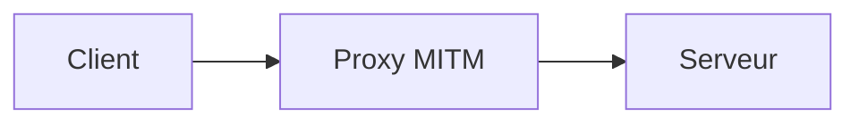
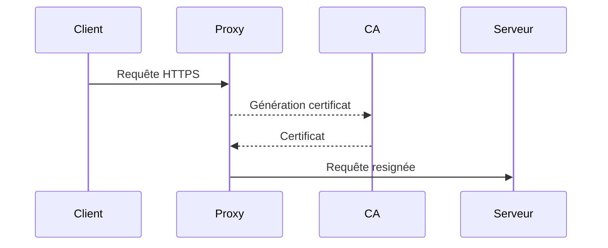
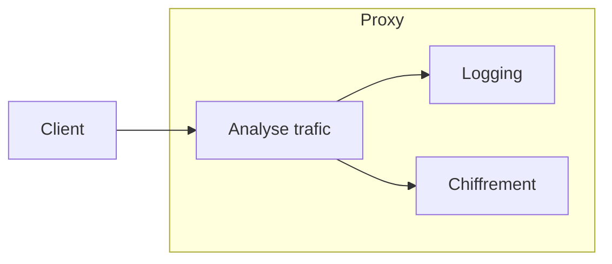
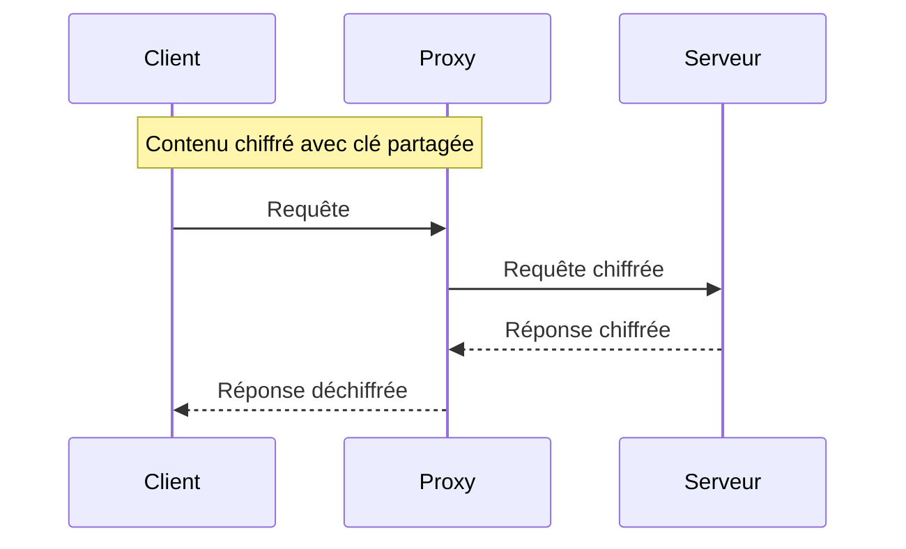
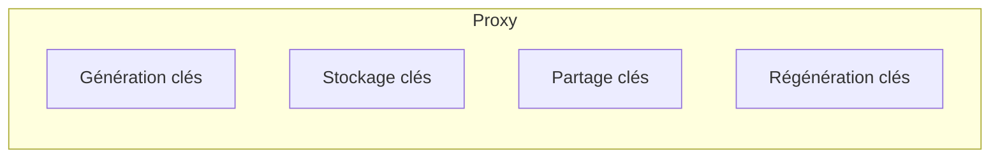
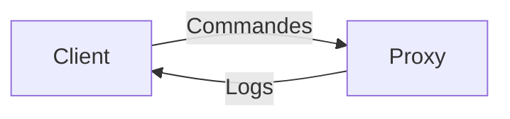
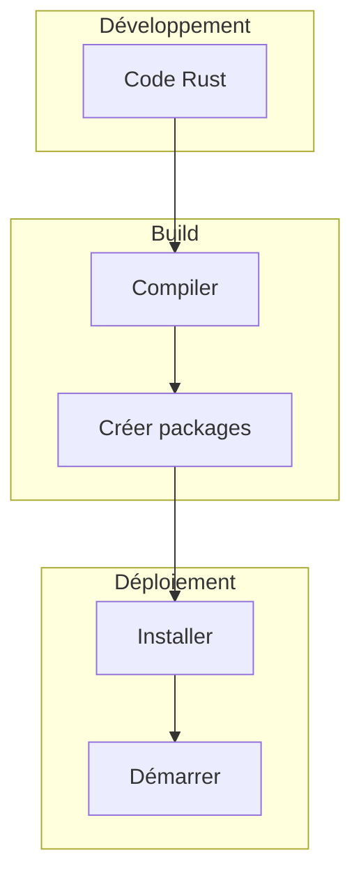

# Etapes de développement

## 1. Mise en place du proxy MITM

- Configurer le proxy pour écouter sur un port local
- Gérer les connexions TCP entrantes
- Logger les requêtes/réponses

## 2. Interception SSL/TLS

- Générer des certificats auto-signés 
- Resigner les requêtes sortantes en HTTPS
- Valider les certificats entrants

## 3. Analyse et logging du trafic

- Parser les requêtes/réponses HTTP
- Extraire et logger les informations utiles
- Filtrer les requêtes à chiffrer

## 4. Chiffrement du contenu

- Chiffrer le contenu textuel ciblé
- Stocker les clés de chiffrement en mémoire
- Déchiffrer les réponses

## 5. Gestion des clés

- Générer des clés symétriques
- Stocker les clés utilisateurs
- Partager les clés entre utilisateurs
- Régénérer les clés compromises

## 6. Interface utilisateur

- Ligne de commande pour contrôler le proxy
- Générer/partager les clés de chiffrement
- Options de configuration

## 7. Packaging et déploiement

- Compiler et packager l'application 
- Scripts d'installation et de démarrage
- Docker, Kubernetes, etc.

